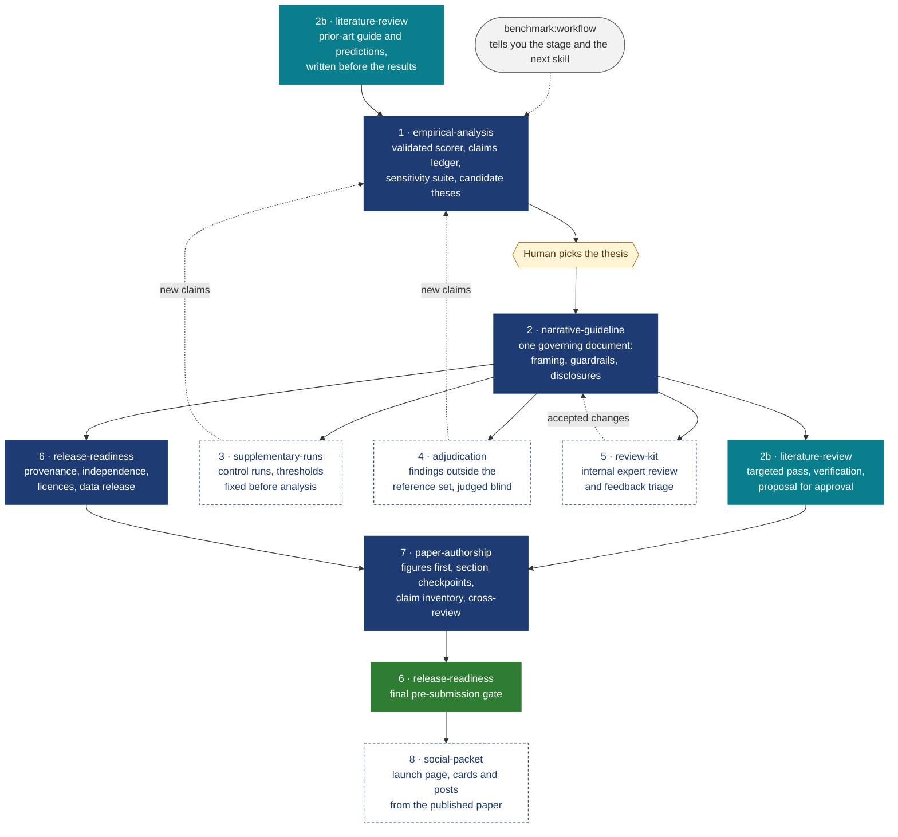

<h1 align="center">Forward Research Skills</h1>

<p align="center">
  <strong>Agent skills for objective, reproducible benchmark research: from raw runs to a published paper.</strong>
</p>

<p align="center">
  <a href="LICENSE"></a>
  <a href="#install"></a>
  <a href="#install"></a>
  <a href="#whats-inside"></a>
  <a href="#requirements"></a>
  <a href="#objectivity-comes-first"></a>
  <a href="https://github.com/snyk-labs"></a>
</p>

---

Benchmark studies go wrong in predictable ways: a scorer nobody re-validated, a number typed by hand that drifts after the next re-run, a thesis picked before the evidence was in, one system configured with more care than the others, a citation nobody opened. **`benchmark`** is a plugin of ten skills that walks an AI agent and a human through a study in the order that prevents those failures, with a human checkpoint wherever a judgement call belongs to a person.

It is written for any study that compares systems on a curated reference set: security scanners, LLM evaluations, retrieval or data-quality studies, anything with a harness, a reference set and a leaderboard.

## Objectivity comes first

> [!IMPORTANT]
> Every stage is run as a neutral third party would run it, because a study is only worth publishing if a reader with no stake in any system would reach the same conclusions from the same data. The skills are written for the hardest case, where an author's employer makes one of the evaluated systems, and the rules apply to every study:
>
> 1. **Same rules for every system.** Scoring, adjudication, wording, caveats and figure treatment are identical, the authors' own product included.
> 2. **Decide before you know.** Scoring policy, outcome thresholds and review rules are fixed before the results they affect are seen.
> 3. **Report against interest.** Every result goes in, including the ones unfavourable to the authors' product.
> 4. **Equal access.** If one system's owner reviews results before publication, every owner is offered the same.
> 5. **Disclose what cannot be made symmetric**, with the direction it could bias the results.

## The workflow



Solid boxes are the main path; dashed boxes are optional stages that run when the evidence needs them. Every number that reaches prose comes from the pipeline's claims ledger, so a control run or an adjudication feeds back into stage 1 rather than into a document by hand.

## What's inside

| Skill | Use it when | What you get |
|---|---|---|
| [`workflow`](plugins/benchmark/skills/workflow/SKILL.md) | You start or resume a study, or don't know what comes next | The current stage, what is missing, the next skill; the cross-stage rules |
| [`empirical-analysis`](plugins/benchmark/skills/empirical-analysis/SKILL.md) | Runs are finished and you need evidence before choosing a story | Study intake, scorer validation, deterministic pipeline, claims ledger, sensitivity and coverage analysis, ranked candidate theses with falsifiers. Stops before any thesis is chosen |
| [`narrative-guideline`](plugins/benchmark/skills/narrative-guideline/SKILL.md) | The thesis is chosen | One governing document: framing, per-finding wording limits, required disclosures, claims never to make |
| [`literature-review`](plugins/benchmark/skills/literature-review/SKILL.md) | You need prior art, a novelty check or verified citations | Prior-art guide, parallel search passes, verification tiers, a proposal you approve before anything is cited |
| [`supplementary-runs`](plugins/benchmark/skills/supplementary-runs/SKILL.md) | A confound blocks a claim and a small control run could resolve it | Cost estimate, outcome thresholds fixed before analysis, a protocol for agent-operated harnesses, checksummed publication |
| [`adjudication`](plugins/benchmark/skills/adjudication/SKILL.md) | Systems reported things the reference set doesn't contain | A review set defined up front, blind two-pass review, human verdicts, reproducers, reporting that never becomes a miss rate |
| [`review-kit`](plugins/benchmark/skills/review-kit/SKILL.md) | An expert should check the findings before publication | A 25–30 minute review PDF built from the ledger, fairness checks for every system, act / decline / future-work triage, draft messages |
| [`release-readiness`](plugins/benchmark/skills/release-readiness/SKILL.md) | Anything is about to become public | Provenance and independence statement, bias sensitivities, licence audit, data release, pre-submission checklist, post-disclosure protocol |
| [`paper-authorship`](plugins/benchmark/skills/paper-authorship/SKILL.md) | The evidence and the guideline exist and the paper must be written | Paper brief, figures from one script, LaTeX skeleton, section checkpoints, a claim inventory checked against the ledger, guardrail lint, cross-review rounds, pre-publication package |
| [`social-packet`](plugins/benchmark/skills/social-packet/SKILL.md) | The paper is public and needs launch material | One shareable launch page (terms, findings with evidence cards, draft quotes, LinkedIn and X posts, guardrails, answers to likely questions), an image pack from the paper's own figure script, a balance check across findings, and a builder that refuses to publish an untraced number |

The skills draft; people decide. No skill sends a message, posts, publishes data, merges a branch or submits a paper. Each one stops and hands back to a human at the checkpoints it names.

### Helper scripts

| Script | What it does |
|---|---|
| `empirical-analysis/scripts/` | Pipeline skeleton: claims registry, evidence-ledger generator with `--check`, statistics helpers (Wilson, cluster bootstrap, exact and mid-p McNemar, Kendall tau), numbered steps, `run_all.py --verify-determinism`, and a synthetic dataset for a dry run |
| `paper-authorship/scripts/check_claims.py` | Checks the paper's claim inventory against the ledger: unknown or wildcard IDs, IDs leaked into the text, values as printed versus the registry, a registry that changed under the paper |
| `paper-authorship/scripts/guardrail_lint.py` | Lints LaTeX and Markdown against rules built from the guideline: forbidden wording, superlatives to verify, placeholders, missing disclosures |
| `paper-authorship/scripts/make_arxiv_bundle.py` | Builds the arXiv source bundle: comments stripped, only the figures and inputs actually used, `main.bbl` kept, compiled clean from a fresh directory, zipped |
| `literature-review/scripts/extract_ids.py` | Lists arXiv IDs and DOIs, for search exclusion lists and a bibliography-versus-accepted check |
| `supplementary-runs/scripts/secret_scan.py` | Scans a release staging directory for credential-shaped strings |
| `release-readiness/scripts/licence_inventory.py` | Lists licence files per unit and flags units without one |
| `review-kit/scripts/build_review_kit.py` | Builds the review PDF from a JSON spec, filling every number from the ledger |
| `social-packet/scripts/build_page.py` | Builds the launch page from a content file and refuses to write it unless every number traces to its claims, every card exists, every X post fits, every quote is marked as a draft and the disclosure is present; prints the balance across findings |

## Install

### Claude Code

```text
/plugin marketplace add snyk-labs/forward-research-skills
/plugin install benchmark@forward-research-skills
```

Or in one step, in a session (Claude Code v2.1.275 or later):

```text
/plugin install benchmark --marketplace snyk-labs/forward-research-skills
```

or from your shell (v2.1.292 or later):

```bash
claude plugin install benchmark --marketplace snyk-labs/forward-research-skills
```

### Claude desktop app, claude.ai and Cowork

Open **Customize > Plugins**, choose **Add > Add marketplace**, and enter `snyk-labs/forward-research-skills`. To install from a file instead, zip the `plugins/benchmark` folder and use **Add > Upload plugin**. See [Plugins on claude.ai and in Cowork](https://claude.com/docs/plugins/overview).

### Try it without installing

```bash
git clone https://github.com/snyk-labs/forward-research-skills.git
claude --plugin-dir forward-research-skills/plugins/benchmark
```

## Quick start

Ask in plain language; the skills trigger on what you describe. Skills are also available as `/benchmark:<skill>`.

```text
/benchmark:workflow  where are we on this study?
Analyze the finished runs in ./results and build an evidence packet. Don't pick a thesis yet.
We picked thesis T2. Write the narrative guideline.
Run the literature review for the method and results sections.
Write the paper.
```

To see the evidence pipeline work end to end on synthetic data:

```bash
cp -R plugins/benchmark/skills/empirical-analysis/scripts ./scripts
python3 scripts/make_synthetic.py demo-data
BENCH_DATA=demo-data BENCH_OUT=demo-packet python3 -B scripts/run_all.py --verify-determinism
```

That writes a claims registry, derived tables and a generated `evidence-ledger.md` into `demo-packet/`, then re-runs everything into a fresh directory with a different hash seed and fails unless both outputs are byte-identical.

## Requirements

- **Python 3.8+**, standard library only, for the pipeline, the checkers, the lint and the release tools.
- **matplotlib** for the figure-script skeleton, **reportlab** for the review-kit PDF, and a **LaTeX** distribution (`latexmk`, `pdflatex`) for the paper.
- An agent with file and shell access, such as Claude Code or Cowork, to run the scripts, and web access for the literature review. In claude.ai chat the skills' guidance is available, but the scripts need one of those environments.

## Repository layout

```text
forward-research-skills/
├── .claude-plugin/marketplace.json      # marketplace manifest
├── plugins/benchmark/
│   ├── .claude-plugin/plugin.json       # plugin manifest
│   ├── README.md
│   └── skills/
│       ├── workflow/                    # router and cross-stage rules
│       ├── empirical-analysis/          # SKILL.md, references/, assets/, scripts/
│       ├── narrative-guideline/
│       ├── literature-review/
│       ├── supplementary-runs/
│       ├── adjudication/
│       ├── review-kit/
│       ├── release-readiness/
│       ├── paper-authorship/            # includes a LaTeX skeleton
│       └── social-packet/
└── LICENSE
```

Each skill keeps its instructions in `SKILL.md`, detail it loads on demand in `references/`, templates to copy in `assets/`, and code in `scripts/`. Copy scripts into your project before running them, so their outputs stay with the project and never land inside the installed plugin.

## Research from Snyk

These skills were distilled from Snyk's own benchmark research. Snyk builds security products, including some of the kinds these studies evaluate, which is why the objectivity rules above are written for the case where an author's employer makes one of the evaluated systems.

Published benchmark research from Snyk:

**Snyk VulnBench** · [vulnbench.com](https://vulnbench.com/) How reliably AI systems find vulnerabilities, with the evidence behind every conclusion.
- *Snyk VulnBench JS 1.0: Can LLMs Find the Same Bugs Twice?* Liran Tal, Johannes Kloos, Arsenii Rudich, Stephen Thoemmes, Manoj Nair. [arXiv:2606.15762](https://arxiv.org/abs/2606.15762) (2026).
- Code and data: [snyk-labs/snyk-vulnbench](https://github.com/snyk-labs/snyk-vulnbench) (benchmark harness), [snyk-labs/snyk-vulnbench-js-1.0](https://github.com/snyk-labs/snyk-vulnbench-js-1.0).

**Snyk VulnBump** · [vulnbump.com](https://www.vulnbump.com/) Whether an AI agent can upgrade a vulnerable dependency without breaking the project.
- *VulnBump: A Benchmark for Fixing Vulnerable Dependencies in Real Projects While Keeping the Build and Tests Green.* Gabija Pasiunaite, Ryan McMorrow, Brian Clark, Liran Tal, Luke Tu. [arXiv:2610.17374](https://arxiv.org/abs/2610.17374) (2026).
- Code: [snyk-labs/snyk-vulnbump](https://github.com/snyk-labs/snyk-vulnbump).

<details>
<summary>BibTeX</summary>

```bibtex
@misc{tal2026snykvulnbenchjs10,
  author = {Tal, Liran and Kloos, Johannes and Rudich, Arsenii and Thoemmes, Stephen and Nair, Manoj},
  title  = {Snyk VulnBench JS 1.0: Can LLMs Find the Same Bugs Twice?},
  year   = {2026},
  eprint = {2606.15762},
  archivePrefix = {arXiv},
  url    = {https://arxiv.org/abs/2606.15762}
}

@misc{pasiunaite2026vulnbump,
  author = {Pasiunaite, Gabija and McMorrow, Ryan and Clark, Brian and Tal, Liran and Tu, Luke},
  title  = {VulnBump: A Benchmark for Fixing Vulnerable Dependencies in Real Projects While Keeping the Build and Tests Green},
  year   = {2026},
  eprint = {2610.17374},
  archivePrefix = {arXiv},
  url    = {https://arxiv.org/abs/2610.17374}
}
```

</details>

## Contributing

Issues and pull requests are welcome. Two rules keep the skills useful to everyone:

- **Keep them generic.** Skills describe a method with placeholders (‹reference set›, ‹evaluated systems›, ‹unit of analysis›); no project's names, numbers or findings.
- **Keep them objective.** A change that would let one system be treated differently from another needs a reason that holds whichever system it favours.

If you change a script, run the pipeline dry run above and `claude plugin validate plugins/benchmark` before opening a pull request.

## License

[Apache License 2.0](LICENSE). Copyright 2026 Snyk Ltd.
